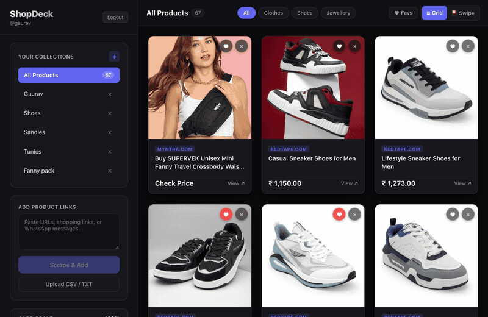

# ShopDeck

A visual shopping shortlist and decision engine for events, outfits, and multi-store product comparisons with a Tinder-style swipe interface.

## Quick Demo



- **Live tunnel demo**: [https://corliss-unveracious-onward.ngrok-free.dev](https://corliss-unveracious-onward.ngrok-free.dev)
- **Local URL**: `http://localhost:5173`

> ⚠️ **Project Status**: ShopDeck is currently a **Proof of Concept (PoC)** designed for personal, local-first use. It runs right on your local machine for your own shopping workflows. Additional features, hardened security, and advanced authentication techniques will be added over time. Feedback, bug reports, and feature requests are very welcome!

---

## 🎯 The Problem

When preparing for an event — a wedding, vacation, party, date, or interview — you rarely buy everything from a single website. You hunt across multiple stores (Amazon, Myntra, Zara, Ajio, Nike, ASOS) for dresses, shoes, bags, and accessories.

This creates several common headaches:

1. **The "Blue Link" Graveyard**: Links get scattered across WhatsApp chats, Apple Notes, Google Keep, or buried browser bookmarks. A raw URL gives you zero visual context.
2. **Tab Overload & Context Switching**: To review your options, you open 20 browser tabs, wait for heavy ecommerce pages to load, dodge popups and cookie banners, and try to remember how item #3 compared to item #17.
3. **The "Final Pick" Dilemma (Decision Fatigue)**: You find 5 pairs of shoes that match your outfit, but you only need to buy one. Comparing them side-by-side across different store layouts and zooming levels is frustrating and inefficient.
4. **No Unified Look Coordination**: There is no easy way to view your shortlisted dress, shoes, bag, and jewelry together on one screen to see if they actually match.

---

## 💡 The Solution

**ShopDeck** replaces messy link dumps with a unified, private visual deck.

- **Drop links in, get products out**: Paste raw URLs, multi-line notes, or WhatsApp message dumps. ShopDeck extracts titles, product images, prices, and sizes automatically.
- **Unified Outfit Canvas**: See your entire look — shoes, dresses, accessories — rendered cleanly side-by-side in one responsive dark-mode view.
- **Tinder-Style Swipe Decision Engine (USP)**: When you've shortlisted 5 options and need to pick the winner, switch to Swipe Mode. Review each item in isolation, favorite contenders, and eliminate the rest with quick keyboard taps or swipe gestures.

---

## ✨ Professional Feature List

### 🛍️ Smart Ingestion & Auto-Scraping
- **Universal Link Parser**: Paste a single link, a batch of URLs, or an unformatted WhatsApp chat snippet. ShopDeck extracts and deduplicates the links.
- **Multi-Store Metadata Extraction**: Pulls clean thumbnails, product titles, prices, and sizes using JSON-LD, OpenGraph, and tailored fallback heuristics.
- **File Upload Support**: Directly import `.txt`, `.csv`, or `.json` files containing product links.
- **Local SQLite Caching**: Scraped items are hashed (MD5) and cached locally so product decks load instantly without re-scraping.

### 🃏 The Decision Engine (Tinder-Style Swipe)
- **1-on-1 Focused Comparison**: Swipe through candidates one card at a time to eliminate distraction and make quick purchase decisions.
- **Tactile Bottom Control Dock**: Quick-action buttons for Rewind (`←`), Pass / Delete (`✕`), Favorite (`♥`), Direct Store Visit (`↗`), and Advance (`→`).
- **Keyboard Navigation**:
  - `Left Arrow` (`←`): Return to previous item
  - `Right Arrow` (`→`): Advance to next item
  - `Spacebar`: Open the retailer's product page in a new tab
- **Swipe Feedback Indicators**: Visual cues for smooth mouse drag or mobile touch gestures.

### 📁 Event & Collection Workspaces
- **Multi-Workspace Organization**: Organize shortlists by event or theme (e.g., *Summer Wedding*, *Bali Vacation*, *Interview Prep*).
- **Auto-Categorization**: Intelligent keyword tagging categorizes items automatically into *Clothes*, *Shoes*, *Jewellery*, and *Other*.
- **Favorites Filter**: Instantly isolate shortlisted items with a single tap on the `♥ Favorites` filter.

### 💻 Unified Responsive Grid
- **Adaptive Screen Sizing**: Clean 2-column layout on phones; auto-expanding multi-column layout on tablets and desktops.
- **Zoom / Scale Control**: Real-time card scale slider (`−` / `+`) to view more products at a glance or inspect card details.
- **Direct Checkout Links**: Every card has a direct store link button to jump straight to the merchant's checkout page.

### 🔒 Privacy, Security & Portability
- **SSRF Protection**: Scraping engine validates URLs and strictly blocks private subnets (`10.x`, `172.16-31.x`, `192.168.x`), loopback addresses (`localhost`, `127.0.0.1`), and cloud metadata IP ranges (`169.254.169.254`).
- **Local-First Privacy**: All lists, user accounts, and cached product data stay in your local database file (`server/products.db`).
- **Multi-User Accounts**: Built-in authentication so friends or family can maintain separate wishlists.
- **Zero-Config Remote Sharing**: Built-in ngrok integration to generate a secure public link for reviewing shortlists on mobile with family or friends.

---

## 🚀 Quickstart

### Prerequisites

- Node.js 20 or 22 LTS (pinned in `.nvmrc`)
- npm 9+
- *(Optional)* [ngrok](https://ngrok.com) for remote tunnel sharing

### 1. Installation

```bash
git clone https://github.com/gdroid7/shopDeck.git
cd shopDeck

# Pin to Node 22 LTS if using nvm
nvm use

# Install dependencies across root, server, and client in one step
npm run setup
```

### 2. Environment (Optional)

```bash
cp .env.example .env
```

### 3. Run Development

**Local development (Web + API):**
```bash
npm run dev:local
```

**Full development with remote tunnel (Web + API + Ngrok):**
```bash
npm run dev
```

Open [http://localhost:5173](http://localhost:5173). Initial default credentials: `admin` / `admin` (or register a new user on the sign-in screen).

---

## 📂 Project Architecture

```
├── client/                     # React 19 + Vite frontend
│   ├── src/
│   │   ├── components/         # ProductCard, ConfirmDialog
│   │   ├── App.jsx             # Main dashboard, swipe deck & workspaces
│   │   └── index.css           # Glassmorphism dark theme styling
│   └── vite.config.js          # Reverse proxy and ngrok allowed hosts
├── server/                     # Express backend
│   ├── index.js                # API routes, auth, scraper & SQLite schema
│   └── products.db             # Local SQLite database
├── scripts/
│   ├── start-ngrok.js          # Port scanner & ngrok tunnel launcher
│   └── record-demo-gif.js      # Headless browser demo recording automation
├── assets/
│   └── demo.gif                # Animated showcase preview
└── package.json                # Root automation scripts
```

---

## 🚀 100% Free Deployment Options

ShopDeck can be deployed with zero ongoing hosting fees:

### Option A: Netlify + Render (Fastest Split Stack)
1. **Deploy Backend to Render**:
   - Create a free account at [Render.com](https://render.com).
   - Create a new **Web Service**, select this repo. Render uses [render.yaml](file:///Users/gaurav/Development/antigravity/local-shop/render.yaml) automatically (`npm run setup && npm run build` -> `npm start`).
   - Copy your Render backend URL (e.g. `https://shopdeck-api.onrender.com`).
2. **Deploy Frontend to Netlify**:
   - Create a free account at [Netlify](https://www.netlify.com).
   - Click **Add new site** -> **Import an existing project** -> Select your GitHub repository. Netlify uses [netlify.toml](file:///Users/gaurav/Development/antigravity/local-shop/netlify.toml).
   - In Netlify Site Settings -> Environment Variables, set:
     - `VITE_API_URL` = `https://your-render-url.onrender.com`
   - Click **Deploy Site**.

### Option B: Oracle Cloud Always Free VM (High Performance All-in-One)
- Deploy the self-contained multi-stage [Dockerfile](file:///Users/gaurav/Development/antigravity/local-shop/Dockerfile) to an Oracle Cloud Always Free VM (4 ARM cores, 24 GB RAM, 200 GB persistent storage):
  ```bash
  docker build -t shopdeck:latest .
  docker run -d --name shopdeck -p 80:3000 -v /var/data/shopdeck:/app/server/data shopdeck:latest
  ```

---

## 🛠️ Status, Roadmap & Feedback

ShopDeck is an early **Proof of Concept**. It is currently designed to run locally on your machine for personal outfit and event curation.

### 🔮 Planned Next Steps
- [ ] Hardened production authentication (OAuth, magic links, session expiry management)
- [ ] Browser extension for 1-click clipping from any shopping site
- [ ] Side-by-side color matching and outfit collage boards
- [ ] Export shortlists to PDF or image lookbooks
- [ ] Currency conversion and price tracking

### 💬 Issues & Feature Requests
Feedback, ideas, and bug reports are warmly welcome! If you have suggestions or encounter an issue with a specific retailer's links, please [open an issue](https://github.com/gdroid7/shopDeck/issues).

---

## 📄 License

MIT © [gdroid7](https://github.com/gdroid7)
